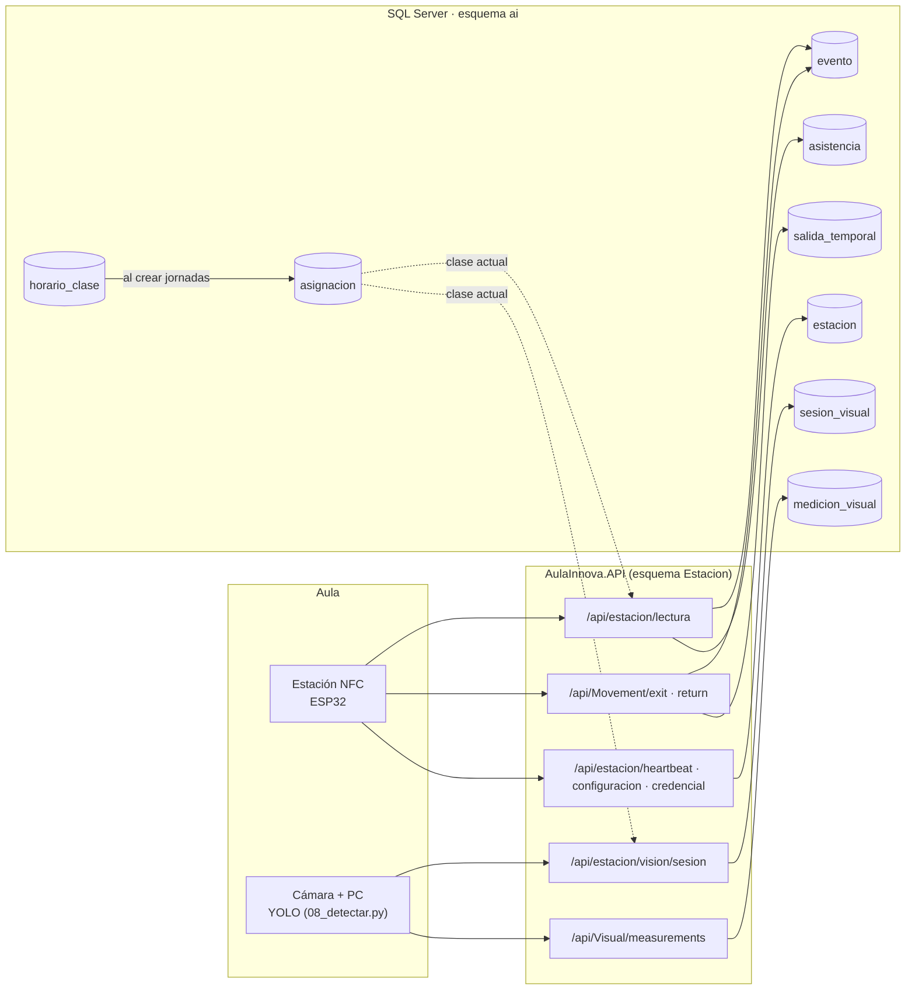
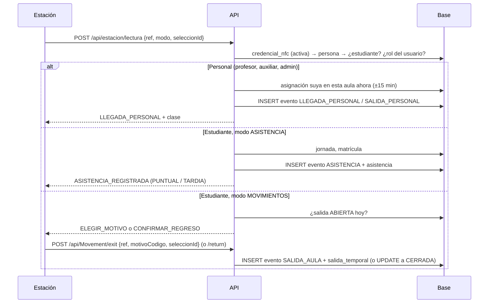
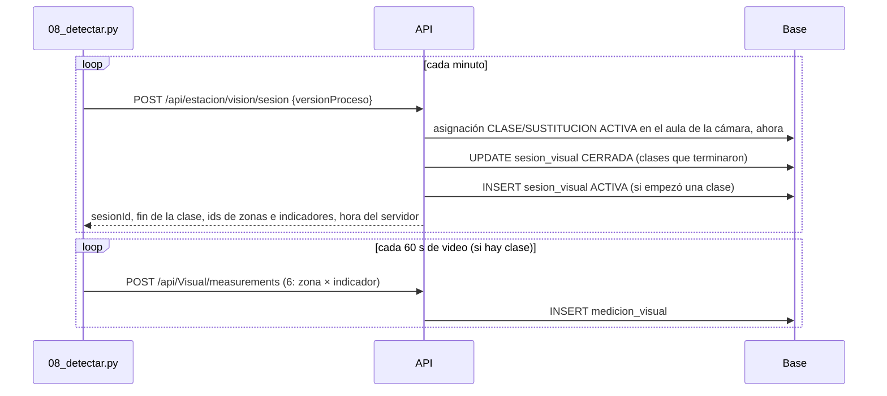

# Flujo de datos: dispositivos → API → base de datos

Cómo llega cada dato de la **estación NFC** y de la **cámara** hasta las tablas
`ai.*` de SQL Server, qué valida la API en el camino y qué pasa cuando no hay red.



---

## 1. Autenticación de los dispositivos

Las estaciones **no** usan usuario y contraseña: cada una tiene su propio
secreto (`ai.estacion_secreto`, solo se guarda el hash SHA-256).

```
X-Estacion-Id:    1
X-Estacion-Clave: 3f2b...c1.Zx9...   ← lo que devolvió POST /api/admin/estaciones/{id}/secret
```

`EstacionAuthenticationHandler` comprueba el hash, que el secreto no esté
revocado y que la estación esté habilitada. El **id de la estación sale de esa
autenticación**: si el cuerpo trae otro `estacionId`, se ignora (una estación no
puede registrar a nombre de otra). La cámara es una estación más.

---

## 2. Del horario a las clases del día

```
ai.horario_clase  (semanal: lunes 7:00-7:45 Matemática 1 A, aula 3C, docente X)
        │  POST /api/admin/jornadas  o  /api/admin/jornadas/rango
        ▼
ai.jornada        (el día: 13/10, 6:00-18:00, límite puntual 7:00)
        │  AsignacionGeneradorService (automático)
        ▼
ai.asignacion     (tipo CLASE, ACTIVA, inicio/fin en UTC, horario_clase_id)
```

- `dia_semana`: **1 = lunes … 7 = domingo**. La hora del horario es **local**
  (`jornada.zona_horaria`, `America/El_Salvador`) y se convierte a UTC.
- Se genera al crear la jornada, con `POST /api/admin/jornadas/{id}/asignaciones`
  y, por si el horario cambió, cada vez que una estación pregunta por la clase
  actual. Nunca duplica: un horario que ya tiene asignación ese día (aunque esté
  CANCELADA) se salta, y tampoco crea una que se cruce con otra del mismo grupo,
  docente o aula.
- **Las asignaciones son las que usan la estación (presencia del docente) y la
  cámara (sesión visual).** Sin jornada ese día, no hay clases.

---

## 3. Estación NFC → API → base

Toda tarjeta entra por **`POST /api/estacion/lectura`**
`{ referenciaNfc, modo, seleccionId, seleccionEdadMs, ocurridoUtc? }`.
La API busca la credencial y decide según **quién** es:



### Qué se guarda en cada caso

| Caso | Tabla | Columnas importantes |
|---|---|---|
| Asistencia | `ai.evento` | `origen=ESTACION`, `accion=ASISTENCIA`, `persona_id`, `credencial_id`, `estacion_id`, `estacion_configuracion_id`, `aula_id`, `jornada_id`, `matricula_id`, `ocurrido_utc`, `calidad_hora`, `estado=ACEPTADO` |
| | `ai.asistencia` | `estado=PRESENTE`, `puntualidad` (PUNTUAL si llegó antes de `jornada.limite_puntual_utc`, si no TARDIA), `evento_llegada_id`. **Una por estudiante y jornada**: pasar otra vez devuelve `ASISTENCIA_YA_REGISTRADA` |
| Salida del aula | `ai.evento` | `accion=SALIDA_AULA`, `motivo_codigo` (BANO, CLINICA, EMERGENCIA, ADMINISTRATIVA, OTRO), `seleccion_id`, `seleccion_edad_ms` |
| | `ai.salida_temporal` | `estado=ABIERTA`, `salida_utc`, `expira_utc` (+15 min, referencia de "salida larga"), `evento_salida_id` |
| Regreso | `ai.evento` | `accion=REGRESO_AULA` |
| | `ai.salida_temporal` | `estado=CERRADA`, `regreso_utc`, `evento_regreso_id`, `horas_fiables` (1 solo si salida y regreso tienen hora del servidor) |
| Personal | `ai.evento` | `accion=LLEGADA_PERSONAL` (1.ª lectura) o `SALIDA_PERSONAL` (2.ª), `asignacion_id` de su clase. Sin clase suya en el aula: `estado=POR_REVISAR`, `codigo_resultado=SIN_ASIGNACION_EN_AULA` |
| Latido / configuración | `ai.estacion` | `ultima_comunicacion_utc`, `modo_reportado`, `modo_reportado_utc` |

- La vista **`ai.vw_cobertura_aula`** toma la última LLEGADA/SALIDA_PERSONAL de
  cada asignación: así la web sabe si el aula tiene adulto
  (`LECTURA_LLEGADA` / `LECTURA_SALIDA` / `SIN_EVIDENCIA`).
- La vista **`ai.vw_estado_asistencia_diaria`** muestra PRESENTE o PENDIENTE
  por estudiante y día.
- Antes de guardar, la estación debe tener la operación habilitada en
  `ai.estacion_operacion` (la crea `POST /api/admin/estaciones/{id}/configuration`
  con `permiteAsistencia` / `permiteMovimientos`): ASISTENCIA; SALIDA_AULA y
  REGRESO_AULA; LLEGADA_PERSONAL y SALIDA_PERSONAL (en cualquiera de los dos).

### Validaciones y códigos de error (400 `{ codigo, mensaje }`)

| Código | Cuándo |
|---|---|
| `REFERENCIA_INVALIDA` | Falta la referencia |
| `CREDENCIAL_NO_REGISTRADA` | No existe en `ai.credencial_nfc`, no está activa o fuera de vigencia |
| `PERSONA_DESHABILITADA` | `persona.habilitada = 0` |
| `ESTACION_SIN_CONFIGURACION` | Sin `estacion_configuracion` vigente |
| `OPERACION_NO_HABILITADA` | La acción no está en `estacion_operacion` |
| `NO_ES_ESTUDIANTE` | Asistencia/salida con tarjeta de personal |
| `SIN_JORNADA` | No hay jornada (no CANCELADA) que cubra la hora |
| `SIN_MATRICULA` | Sin matrícula vigente en la fecha de la jornada |
| `ESTACION_SIN_AULA` | Salida en una estación de ACCESO |
| `MOTIVO_INVALIDO` | Motivo inexistente o deshabilitado |
| `SALIDA_YA_ABIERTA` / `SIN_SALIDA_ABIERTA` | Salida sin regresar / regreso sin salida |
| `REGRESO_ANTES_DE_SALIDA` | Hora de regreso anterior a la salida |
| `HORA_NO_UTC` / `HORA_FUTURA` | `ocurridoUtc` sin `Z` o más de 2 min en el futuro |
| `MODO_INVALIDO` | `modo` distinto de ASISTENCIA / MOVIMIENTOS |
| `SELECCION_REPETIDA` | El mismo `seleccionId` ya se usó para otra acción |

401/403 = clave de la estación mal o revocada. 5xx = error del servidor (la
estación guarda y reintenta).

### Sin red: hora declarada y sin duplicados

- La estación guarda en la microSD `tipo;ref;motivo;horaUTC;seleccionId;edadMs;modo`
  y lo reenvía con **`ocurridoUtc`**.
- Con `ocurridoUtc` la API guarda `calidad_hora = DECLARADA` (no FIABLE) y la
  asistencia queda con `puntualidad = PENDIENTE`: alguien la clasifica después,
  porque la hora la puso el reloj de la estación, no el servidor.
- **`seleccion_id`** es único por estación (`UX_evento_estacion_seleccion`). Si
  el mismo registro llega dos veces (se cortó la red tras guardar), la API
  devuelve el resultado original (`repetida: true`) en vez de duplicarlo.
- Si la estación se reconfiguró mientras estaba sin red, el registro atrasado se
  guarda con la configuración vigente (no se pierde).

---

## 4. Cámara → API → base

La PC de la cámara corre `dispositivos/vision/tools/08_detectar.py` todo el
día. Nunca guarda ni envía imágenes: solo números por minuto.



| Tabla | Qué se guarda |
|---|---|
| `ai.sesion_visual` | Una por clase: `asignacion_id`, `aula_id`, `inicio_utc`, `fin_utc`, `estado` (ACTIVA → CERRADA), `version_proceso`, `autorizada_por` = el administrador que configuró la cámara en esa aula, `referencia_autorizacion` |
| `ai.medicion_visual` | Una por ventana × zona × indicador: `inicio_utc`, `fin_utc`, `valor`, `valida`, `motivo_invalidez` (CAMARA_SIN_IMAGEN, SIN_ESTUDIANTES_RASTREADOS), `muestras_validas`, `muestras_totales` |
| `ai.zona_visual` / `ai.indicador_visual` | Se crean **una vez** con `07_configurar_api.py` (DOCENTE, ESTUDIANTES, PUERTA · OCUPACION_PROMEDIO, INDICE_MOVIMIENTO, TRANSICIONES) |

Reglas que aplica la API a cada medición:
- La sesión existe y está ACTIVA, o CERRADA si la ventana cae antes de su fin
  (así lo que quedó en `pendientes.jsonl` sin red no se pierde).
- Solo la estación configurada en **el aula de la sesión** puede enviar (si no: 403).
- `inicio_utc ≥` inicio de la sesión y `fin_utc ≤` ahora y `≤` fin de la sesión.
- Zona del aula, indicador habilitado, sin ventana duplicada.

El detector recorta cada ventana al inicio de la sesión y al fin de la clase, y
manda las horas en "hora del servidor" (calcula el desfase de su reloj). En
recreos o fuera de horario no hay sesión y no envía nada.

---

## 5. Quién usa estos datos

| Dato | Desde dónde se consulta |
|---|---|
| Asistencia del día | `ai.vw_estado_asistencia_diaria` |
| Salidas abiertas / duración | `ai.salida_temporal` (`estado`, `expira_utc`, `horas_fiables`) |
| ¿Hay adulto en el aula? | `ai.vw_cobertura_aula` |
| Indicadores visuales de una clase | `GET /api/Visual/sessions/{id}/measurements` (permiso VISION_LEER) |
| Estado de las estaciones | `GET /api/admin/estaciones` (`ultimaComunicacionUtc`, `modoReportado`) |
| Horario del profesor (móvil) | `GET /api/profesor/horario?dia=1..7` |

Pendiente para la web/móvil: un endpoint para listar las sesiones visuales de
una asignación y otro que lea `vw_cobertura_aula` (hoy solo se consultan en SQL).
